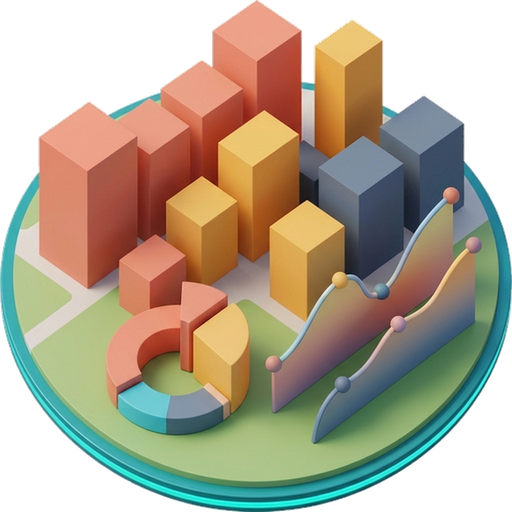
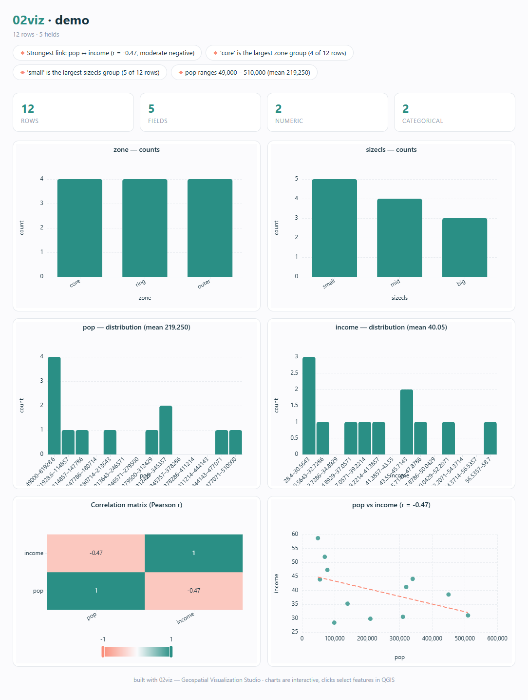
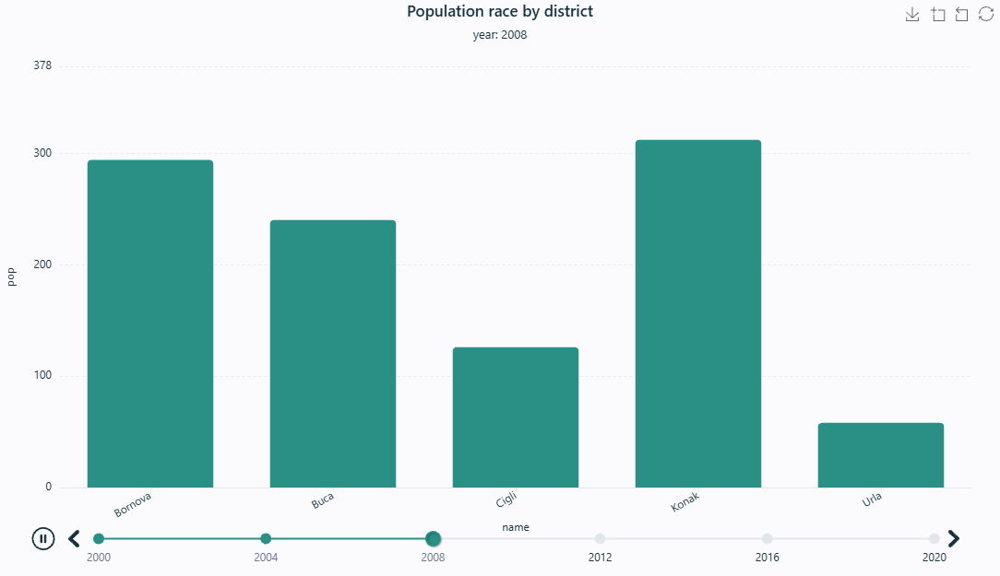
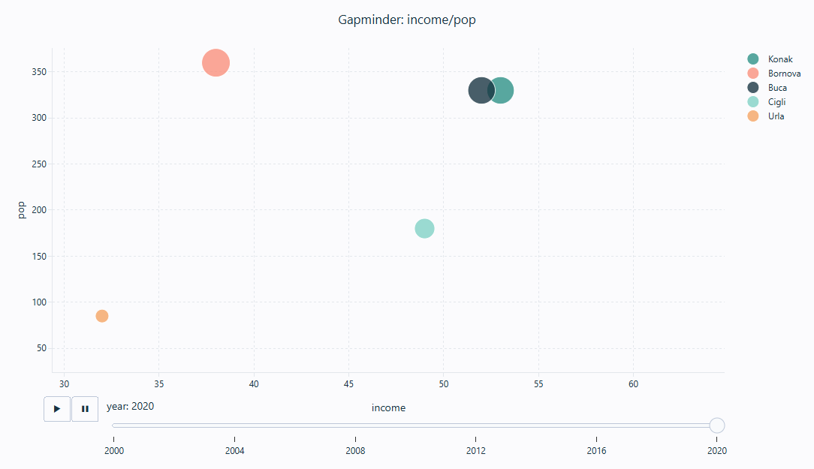
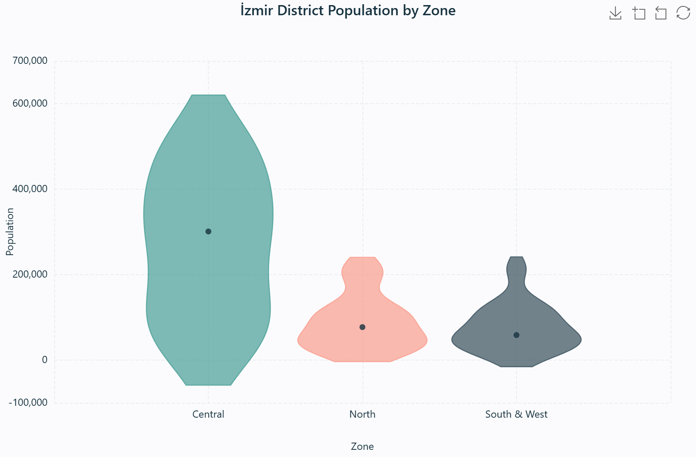
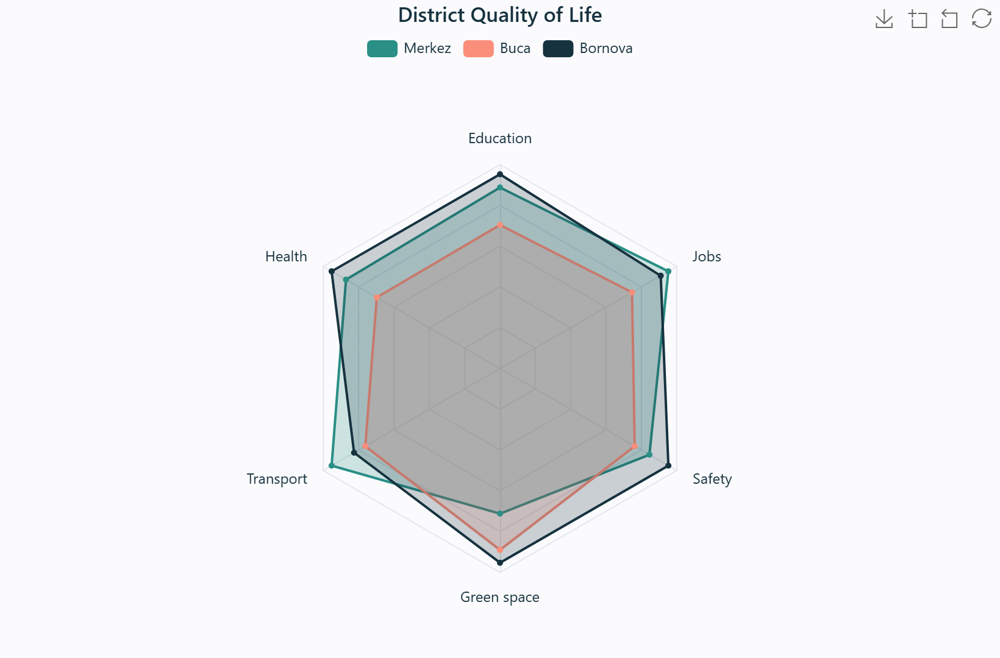
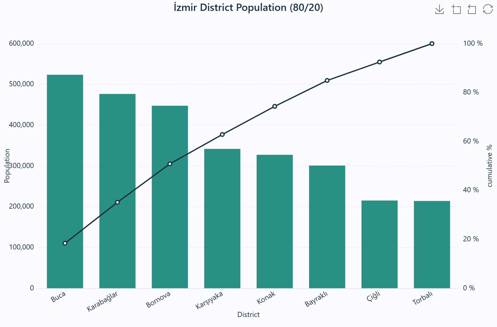
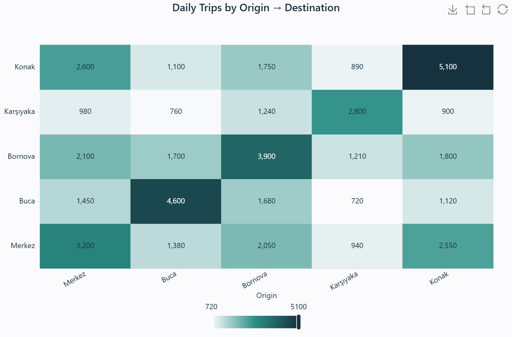
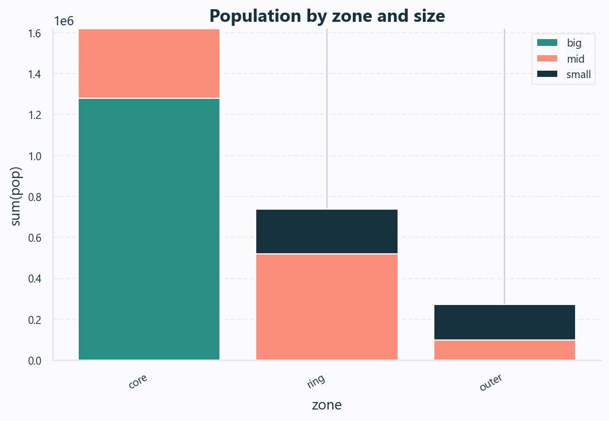

# 02viz — Geospatial Visualization Studio

**Geospatial data visualization studio: multi-engine, interactive, publication-quality charts from QGIS layers and external data.**

---

## 📖 Documentation

**[Reference manual](https://geophilo.com/zero2viz/)** — features, parameters and workflows, last revised for v0.16.0. Later features are described below, in the [changelog](CHANGELOG.md) and in the plugin's built-in **❔ Guide**, which works offline.

## Why 02viz?

**Zero2Visual — from zero to elegant visuals, fast.** Charting in GIS has always meant exporting attribute tables to a spreadsheet, or wrestling with one fixed plotting library. 02viz puts a full visualization studio inside QGIS, organised as **one dock with three tabs — Charts, Map diagrams and Labels** — three ways to turn a layer's data into a publication-quality visual that stays linked to the map. It is built for planners, analysts and cartographers who want their visuals to match the quality of their maps.

SmartModeler GIS can also open 02viz for one live project vector layer and run
the same fully offline smart chart suggestion after you approve its
`plugin_action` card. This narrow bridge accepts no file path, export, URL,
expression, custom specification, or arbitrary plugin method; feature values
remain inside QGIS and 02viz.

## 🆕 What's new in 0.20.0

- **A panel that fits a narrow dock** — no sideways scrolling at 350 pixels: the layer and fields come first, the engine sits under *Advanced*, all exports share one **Export** menu, **Render chart** and the status line stay pinned at the bottom, and the view scrolls to the chart after rendering (GitHub issue #2).
- **Charts that show the data as it is** — Plotly keeps category codes such as "30" or "2024-03" on a category axis, the Top-N "Other" bar uses your aggregate, dates sort as dates, histogram bins keep distinct labels, empty values are skipped instead of drawn as 0, the bar-chart race re-sorts every frame, Pareto refuses negative values and true/false fields are counted.
- **Horizontal bars and reversed axes** — bar, lollipop and histogram charts can run horizontally and either axis can be reversed, the wish from GitHub issue #1.
- **Use layer colours** — chart categories take the colours of the layer's categorized or rule-based style, so the chart and the map legend agree.
- **Honest, vector exports** — SVG comes from each engine's own vector output and PDF is made from it, so both stay sharp at any zoom; PNG is saved at the size you choose; image export is offered only while a rendered chart is on screen.
- **Safe chart pages** — titles and values are escaped, so a layer or field value containing HTML can no longer break a chart page or run script in it.
- **Tidier** — one temporary file per panel, removed on unload; charts redraw after you edit the charted layer; the matplotlib engine leaves global plotting settings alone; external CSV columns keep their types; the panel restores your last setup when it reopens.

## ✨ Features

- **One dock, three tabs** — **Charts** (interactive web charts), **Map diagrams** (native diagrams on every feature) and **Labels** (quick elegant labels), all sharing one layer selector.
- **One-click Explore** — pick a layer, press one button: 02viz profiles every field and builds a complete interactive dashboard — KPI cards (with overall **completeness**), a collapsible **field-summary table** (type · missing % · distinct · range/top), a chart per field, a **normalised box plot** putting every numeric field on one comparable 0–1 axis, a Pearson correlation matrix, the strongest-relationship scatter with trend line, and plain-English insight chips — dominant category, range, **skew with a log-transform hint**, **outliers**, near-constant and mostly-empty fields, notable correlations. Identifier columns (fid/id/gid/uuid) are skipped.
- **Built-in guide + smart suggestions, fully offline** — a **❔ Guide** button opens a designed, self-contained HTML user guide (what each part of the studio does, the normalisation modes, copy-ready label-expression recipes, and prompts for an external AI assistant), and a **💡 Suggest** button reads the active layer's fields to configure and render the most insightful chart for you — telling you *why*. No account, no internet, no new dependencies.
- **Twenty chart types, zero setup** — bar (grouped/stacked, vertical or horizontal), lollipop (Cleveland dot-and-stem), line, area, scatter, bubble, histogram, pie/donut, box plot, heatmap, treemap, sunburst, mean ± σ band, mean ± σ bars, density (KDE), violin, radar/spider, Pareto (80/20), ECDF (cumulative step distribution) and Lorenz & Gini inequality curve.
- **Animated charts — a play axis** — pick a time or sequence field and any **bar, lollipop, line, area, scatter, bubble or pie** chart plays through it: a **bar-chart race**, **Gapminder-style bubbles**, composition or trends unfolding over the years. An auto-play timeline (ECharts) or a slider with play/pause (Plotly), with colours and the value axis held steady across frames so things animate *in place* — a bar-chart race re-sorts its bars every frame — and animated bars/points still click to select features on the map. Pure Python, fully offline, and the animation exports in the one-file HTML.
- **Small multiples across all four engines** — **Facet by** a field and a bar, lollipop, line, area, scatter, bubble or pie chart becomes a grid of panels, one per group, all on one value axis with one colour key, so regions, years or land uses compare side by side across ECharts, Plotly, Vega-Lite and matplotlib. Stacked panels stack within their own panel and the axis covers the tallest stack. Up to 12 panels; the groups left out are named.
- **Animated Explore** — **Explore: animate by** a year or phase field and the whole dashboard plays: count bars, histograms, the scatter and the Rows / Complete cards step together on one play bar, on the whole layer's categories and bin edges.
- **Reference & statistics overlays** — drop horizontal guide lines and shaded bands onto **bar, lollipop, line, area, scatter and bubble** charts: the **mean**, the **median**, a **target** value you type, a **±1σ** band and the **inter-quartile** (Q1–Q3) band. Computed in pure Python from the plotted values and drawn identically by all four engines, so they read the same in light and dark and export with the chart.
- **Four engines** — choose a chart type and fields; the engine (under *Advanced*) decides how it is drawn, and chart types an engine cannot draw are greyed out. ECharts and Plotly draw all 20 types, Vega-Lite 17 and matplotlib 15. Three are vendored and fully offline (Apache ECharts, Plotly.js, Vega-Lite); the optional **matplotlib** engine renders publication-grade *static* figures, with seaborn styling when seaborn is installed. matplotlib ships with OSGeo4W QGIS on Windows; when it is missing, 02viz shows the exact command that installs it into the QGIS Python. The core studio stays dependency-free.
- **Map diagrams on the canvas, with normalisation** — native QGIS **pie / bar / stacked-bar / text** diagrams on every feature, sized in millimetres and coloured with the studio palette. Optionally **normalise** the fields — **Min–max (0–1)**, **Z-score** or **Log** — so a pie or bar compares fields on very different scales fairly instead of one big-number field swamping the rest (min/max/mean/std are computed from the features and baked into the diagram expressions — nothing is written to your data). They print and export to layout like any symbology.
- **Expression-driven labels** — turn fields into well-placed labels with a preset (clean subtle-halo / strong halo / bold / plain) and **format them without leaving the dock**: round numbers, thousands separators, a prefix/suffix or units, change case, word-wrap, stack a **second field on its own line**, or type **any QGIS expression** — with a live preview and a first-feature sample. Built on native QGIS labeling.
- **Publication-grade output** — one type system, soft dashed gridlines, clean card tooltips, rounded bars and minimal axes across every engine.
- **Chart → map selection** — click a bar, slice or point and the matching features are selected on the canvas, on every QGIS web stack (crash-safe title transport, no QWebChannel needed). Editing the charted layer redraws the chart, so a click always selects the right features. matplotlib figures are static images and do not take clicks.
- **Map → chart highlight** — select features on the canvas and the chart highlights them and dims everything else, without a re-render; works in single charts and across every dashboard tile.
- **Live mode** — optionally re-render on every canvas selection change; "Only selected features" scopes any chart to your selection.
- **Built-in data shaping & statistics** — aggregation (count/sum/mean/median/min/max/std/iqr), group/color-by field, Top-N with "Other" collapse, value sorting, least-squares trend line, reference & statistics overlays (mean, median, target, ±1σ and inter-quartile bands), histogram binning, box-plot quartiles, sample standard deviation, Silverman-bandwidth Gaussian KDE (with non-negative support clamping), empirical CDF quantiles, Lorenz curves and Gini inequality coefficients — all pure Python, no pandas/numpy needed.
- **Layers and beyond** — chart any vector layer or attribute table, or load external CSV/XLSX/ODS tables straight into the studio. CSV files open through the QGIS delimited-text reader with type detection, so numbers and dates stay numbers and dates.
- **Four themes, eight palettes + an embedded swatch editor** — Studio Light, Ink Dark, Soft Pastel and Bold Print themes, a Colors selector with 8 curated palettes (Vivid, Colorblind safe, Viridis, Sunset, Ocean, Earth, Berry, Grayscale print), and **inline swatches right in the dock** — click one to recolour it, `+`/`−` to resize the palette. All override the theme palette identically in every engine.
- **Layer colours** — tick *Use layer colours* and chart categories take the symbol colours of the layer's categorized or rule-based style, so the chart matches the map legend; categories the style does not cover keep the palette colours.
- **Multi-format export** — save the current chart as a self-contained
  interactive HTML page, a vector SVG drawn by the chart engine itself, a
  vector PDF made from that SVG, or a PNG at the size you choose. PNG, SVG and
  PDF are offered only while the view shows a rendered chart. Every file is
  written to a temporary name first and then moved into place, so a failed
  export cannot destroy an existing file.
- **Visible data scope** — the render status and Explore dashboard state whether
  every available row was analysed or the responsive 100,000-row safety window
  was used; large-layer charts are never silently presented as full-dataset
  results.
- **Qt5 and Qt6 ready** — runs on QGIS 3.28+ and the QGIS 4 line, with a WebEngine → WebKit → browser viewer fallback chain.

## 🖼️ Gallery

**Animated charts — a play axis.** Pick a year (or any sequence) field and the chart plays through it, with the value axis and colours held steady; a bar-chart race re-sorts its bars every frame:

| Bar-chart race (ECharts timeline) | Gapminder bubbles (Plotly slider) |
|:---:|:---:|
|  |  |

A few of the twenty chart types, rendered offline by the vendored JS engines and styled for publication:

| Violin (KDE) | Radar / spider |
|:---:|:---:|
|  |  |
| **Pareto (80/20)** | **Correlation heatmap** |
|  |  |

The optional **matplotlib** engine renders the same spec as a publication-grade static figure:

## 🚀 Installation

**From the QGIS Plugin Hub (recommended):** `Plugins → Manage and Install Plugins…` → search for **"02viz"** → *Install*.

**From a release zip:** download the latest zip from [Releases](https://github.com/YusufEminoglu/zero2viz/releases) → `Plugins → Install from ZIP`.

Requires QGIS 3.28 or newer. **No external Python dependencies for the core studio** (the three JS engines are vendored). The optional matplotlib engine is auto-detected; matplotlib ships with OSGeo4W QGIS on Windows. When it is missing, the plugin shows you the exact command that installs it into the QGIS Python, for you to run yourself (it never runs pip for you).

**Reusable chart presets** save a named setup across QGIS sessions: engine,
chart type, field bindings, shaping, animation, selection scope, styling,
reference overlays and custom Vega-Lite JSON. Load the same preset on another
layer with a matching schema; unavailable fields are cleared and reported.
The panel also restores your last setup when it reopens.

## 📖 Quick start

1. Install 02viz and click the **02viz Studio** toolbar button — the studio dock opens on the right.
2. Pick a layer (or **Load external table…** for a CSV/XLSX/ODS), optionally tick *Only selected features*.
3. On the **Charts** tab pick the chart type, set the X/Y fields and an aggregation if you want grouping — or press **💡 Suggest** to let 02viz configure the most suitable chart for your fields. The engine and less-used options sit under **Advanced**.
4. Hit **Render chart**, pinned at the bottom of the panel — the interactive chart appears in the dock and the view scrolls to it.
5. Use the **Export** menu: HTML stays interactive and completely offline; SVG
   is a vector file drawn by the chart engine and PDF a vector file made from
   it; PNG is saved at the size you choose. The **Map diagrams** and **Labels**
   tabs draw straight onto the canvas. New to it all? Open **❔ Guide**.

## ⚙️ Reference

| Group | Component | What it does |
|-------|-----------|--------------|
| Data (shared) | Layer combo + selected-only | Binds any vector layer/table; respects canvas selection |
| Data (shared) | Live: redraw on selection | Re-renders the chart whenever the layer selection changes |
| Data (shared) | Load external table… | Opens CSV tables through the QGIS delimited-text reader with type detection and XLSX/ODS/GPKG/DBF tables via OGR, and adds them to the layer list |
| Charts | Type / Engine / Theme / Colors | 20 chart types; 4 engines (ECharts and Plotly draw all 20, Vega-Lite 17, the optional matplotlib engine 15); 4 themes; 8 palettes + inline custom swatches |
| Charts | Use layer colours | Categories take the symbol colours of the layer's categorized or rule-based style; the rest keep the palette |
| Charts | Horizontal bars / reversed axes | Bar, lollipop and histogram bars run horizontally; either axis can be reversed (GitHub issue #1) |
| Charts | X / Y / Group / Value-Size / Title | Field bindings + a chart-title override; Group splits colored series, Value drives bubble size, heatmap cells and treemap weights |
| Charts | Facet by ▦ | Small multiples for bar, lollipop, line, area, scatter, bubble and pie charts: one panel per value of a field (up to 12 — the largest groups, in their natural order), shared value axis and colour key across all 4 engines; either/or with Animate by |
| Charts | Animate by ▶ / Play speed | Play a bar/lollipop/line/area/scatter/bubble/pie chart through a time or sequence field — bar-chart race, Gapminder bubbles, composition over years (ECharts timeline / Plotly slider) |
| Charts | Aggregate / Bins / Top N / Sort | count·sum·mean·median·min·max·std·iqr, histogram bins, Top-N with "Other", value sorting |
| Charts | Explore: animate by ▶ | Play the whole Explore dashboard through a field: count bars, histograms, scatter and Rows / Complete cards step together on one play bar |
| Charts | Render / 💡 Suggest / ✨ Explore / Export / ↗ | Render to the embedded viewer (WebEngine → WebKit → browser), one-click chart suggestion, one-click Explore dashboard, one Export menu (interactive HTML, vector SVG and PDF, PNG at a chosen size, all written atomically), open-in-browser fallback |
| Header | ❔ Guide | Full offline user guide with per-layer suggestions and copy-ready expression/AI-prompt recipes |
| Map diagrams | Type / Fields / Size / Opacity / **Size by** / Avoid overlaps / **Normalize** | Native QGIS pie/bar/stacked/text diagrams on every feature; Size by scales each diagram between a small and a full-size one by a chosen field (proportional-symbol maps); Normalize = None / Min–max (0–1) / Z-score / Log makes differently-scaled fields comparable |
| Labels | Field / Second line / Decimals / Thousands / Prefix-Suffix / Case / Wrap / Expression / Style (incl. **Chip**) / Size | Formatted, multi-line, expression-driven labels via native QGIS labeling, with a live preview |

## 🧩 Part of the PlanX ecosystem

02viz is one of 30 QGIS plugins by the same author. Some of them:

| Planning & analysis | CAD & production | 3D & visualization |
|---|---|---|
| [PlanX](https://github.com/YusufEminoglu/PlanX) — spatial-planning suite | [PlanX CAD Toolset](https://github.com/YusufEminoglu/PlanX-CAD) — drafting-grade CAD | [PlanX 3D City](https://github.com/YusufEminoglu/planx_3d_city) — Three.js city viewer |
| [GeoStats Lab](https://github.com/YusufEminoglu/planx_geostats) — spatial statistics | [EasyFillet](https://github.com/YusufEminoglu/EasyFillet) — tangent-arc fillet | [3D OSM Model](https://github.com/YusufEminoglu/osm_3d_model) — OSM → 3D city in browser |
| [Suitability Lab](https://github.com/YusufEminoglu/planx_suitability_lab) — raster MCDA | [Settlement Toolset](https://github.com/YusufEminoglu/PlanX-Settlement) — 9-stage settlement plans | [OSM Quick 3D](https://github.com/YusufEminoglu/osm_quick_3d) — OSM → native QGIS 3D |
| [DataCube Lab](https://github.com/YusufEminoglu/planx_datacube) — spatiotemporal cubes | [UIP Toolset](https://github.com/YusufEminoglu/PlanX-UIP) — Turkish zoning-plan (UIP) automation | [Urban Procedural 3D](https://github.com/YusufEminoglu/planx_urban_procedural_3d) — parametric zoning lab |
| [Urban Resilience](https://github.com/YusufEminoglu/planx_urban_resilience) — seismic, flood, heat and social vulnerability | [ParcelFlux](https://github.com/YusufEminoglu/parcelflux) — parcel subdivision | [02CartoLab](https://github.com/YusufEminoglu/zero2cartolab) — publication cartography |

## 📜 License & author

GPL-3.0-or-later © [Yusuf Eminoğlu](https://github.com/YusufEminoglu) — bug reports and feature requests welcome in [Issues](https://github.com/YusufEminoglu/zero2viz/issues).
